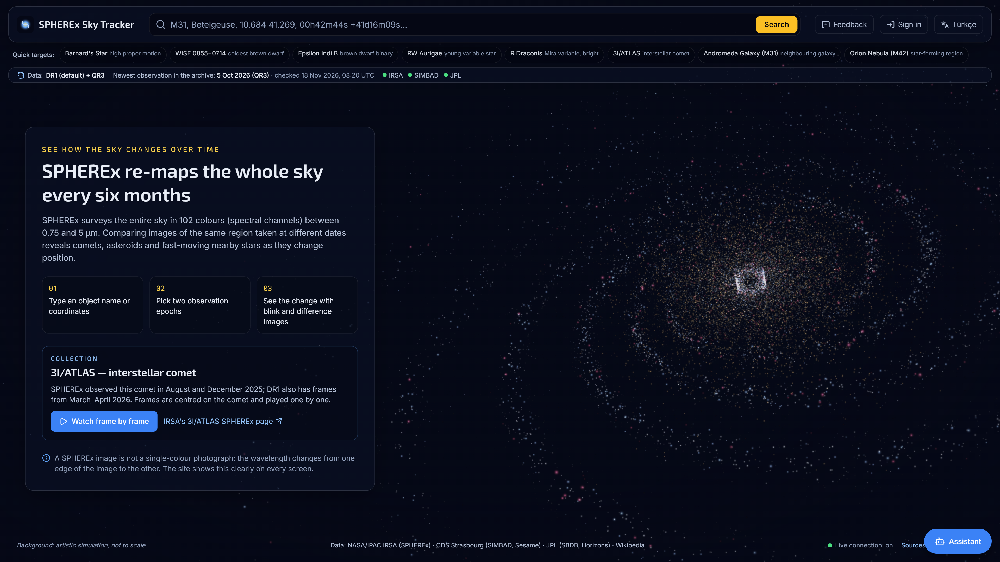

# 🛰️ SPHEREx Observer

**Near-Infrared All-Sky Spectral Mapping, Multi-Epoch Astronomy & Moving Celestial Object Analysis Platform**

[](https://spherex-izleyici.onrender.com)
[](https://spherex-izleyici.onrender.com)
[](./LICENSE)

> 🚀 **Live Application:** You can explore the live platform directly in your browser at **[https://spherex-izleyici.onrender.com](https://spherex-izleyici.onrender.com)**



## 📖 Table of Contents

 1. [Overview](#-overview)
 2. [Mission & Vision](#-mission--vision)
 3. [Key Features](#-key-features)
 4. [UI Tour & Screenshots](#-ui-tour--screenshots)
 5. [System Architecture & Scientific Foundation](#-system-architecture--scientific-foundation)
 6. [Tech Stack](#-tech-stack)
 7. [Project Structure](#-project-structure)
 8. [Getting Started & Installation](#-getting-started--installation)
 9. [API & Data Sources](#-api--data-sources)
10. [Roadmap](#-roadmap)
11. [Contributing & License](#-contributing--license)

## 🌌 Overview

**SPHEREx Observer** (*SPHEREx Gökyüzü İzleyici*) is an interactive web-based observation, multi-epoch infrared astronomy, and moving celestial object analysis platform built around NASA's **SPHEREx** (*Spectro-Photometer for the History of the Universe, Epoch of Reionization and Ices Explorer*) space telescope mission.

🔗 **Try it Live:** **[https://spherex-izleyici.onrender.com](https://spherex-izleyici.onrender.com)**

The SPHEREx mission surveys the entire sky in near-infrared light (spanning wavelengths from $0.75\ \mu\text{m}$ to $5.0\ \mu\text{m}$) across **102 distinct spectral color bands**, gathering spectroscopic data on more than $450\text{ million}$ galaxies and over $100\text{ million}$ stars within the Milky Way. **SPHEREx Observer** transforms this vast scientific framework into an accessible, visually engaging, and interactive experience for researchers, students, and space enthusiasts alike.

## 🚀 Mission & Vision

* **Our Mission:** To transform the massive 102-band infrared dataset of the SPHEREx telescope into an open-access, high-speed discovery tool that anyone can analyze with scientific accuracy within seconds directly from their browser.
* **Our Vision:** To become a standard platform for discovering dynamic changes in the universe for both professional researchers and citizen scientists by making complex space observation data accessible.

### 🎯 Core Objectives

* **Complex Data Visualization:** Transforming raw spectroscopic curves, light curves, and astrometric telemetry into intuitive charts and interactive views.
* **Multi-Epoch Target Tracking:** Analyzing high-proper-motion stars, brown dwarfs, and variable targets across multiple infrared observation epochs.
* **Science Communication & Education:** Demonstrating cosmic inflation, cosmological redshift ($z$), and absorption spectra of biogenic interstellar ices ($\text{H}_2\text{O}$, $\text{CO}_2$, $\text{CO}$, $\text{CH}_3\text{OH}$) through hands-on web modules.

## ✨ Key Features

* 🛰️ **Multi-Epoch Target & Astrometry Tracker:** Tracks moving celestial objects, proper motion vectors, and coordinates across multi-epoch infrared sky surveys.
* 🌈 **Interactive Near-Infrared Spectrum & Light Curve Analyzer:** Simulates Linear Variable Filter (LVF) observations across the $0.75\ \mu\text{m}$ to $5.0\ \mu\text{m}$ range, highlighting emission, variability, and absorption features of celestial targets.
* 🗺️ **Multi-Layer Sky Survey Viewer:** Coordinate-based ($\text{RA} / \text{Dec}$) celestial map supporting seamless transitions between optical and near-infrared survey layers, including SPHEREx Deep Fields.
* 🧮 **Redshift ($z$) & Cosmological Distance Calculator:** Interactive tool that derives galaxy recession velocity, lookback time, and comoving distance directly from observed wavelength shifts.
* 📊 **Scientific Mission Dashboard:** Dynamic information cards detailing quality flags, header metadata, and core science pillars.
* 📱 **Fully Responsive Dark-Mode UI:** Astronomy-grade dark interface designed with modern glassmorphism and responsive layouts for both desktop and mobile viewports.

## 📸 UI Tour & Screenshots

Below is a complete visual walkthrough of every module available in the **[SPHEREx Observer](https://spherex-izleyici.onrender.com)** platform:

### 1. Hero Section & Mission Control Overview

The main landing area featuring dynamic space visuals, target search controls, quick navigation, and a high-level summary of SPHEREx parameters.


### 2. Multi-Epoch Target Tracking & Telemetry Simulation

Displays real-time target coordinates, astrometric motion vectors, and observation windows along SPHEREx's survey path.


### 3. Spectroscopic Data, Light Curve & Redshift ($z$) Panel

Interactive spectral and photometric plotter that maps flux density against wavelength ($\mu\text{m}$) and time, identifying molecular absorption bands and variability.


### 4. Interactive Sky Map & Deep Space Explorer

Explore the all-sky survey grid and polar deep fields using Right Ascension ($\alpha$) and Declination ($\delta$) celestial coordinates.

| All-Sky Survey View | Deep Field Infrared Layer |
| ----- | ----- |
|  |  |
| *102-Band All-Sky Spectral Mapping* | *High-Sensitivity Deep Field Targets* |

### 5. Spacecraft Hardware, Science Pillars & Mobile Experience

Detailed breakdown of telescope optics, data quality diagnostics, and responsive mobile layout.

| Hardware & Science Pillars | Mobile Responsive View |
| ----- | ----- |
|  |  |
| *Optical Payload & Core Science Objectives* | *Adaptive Mobile User Interface* |

## 🔬 System Architecture & Scientific Foundation

The platform relies on rigorous astrophysical and astrodynamical models to drive its calculators and visual simulations:

### 1. Spectroscopic Redshift ($z$) Calculation

As the universe expands, photons emitted by distant galaxies are stretched toward longer (redder) wavelengths. The built-in analysis engine computes dimensionless redshift $z$ from the observed wavelength ($\lambda_{\text{observed}}$) and rest-frame laboratory wavelength ($\lambda_{\text{rest}}$):

$$z = \frac{\lambda_{\text{observed}} - \lambda_{\text{rest}}}{\lambda_{\text{rest}}}$$

For low-redshift regimes, radial recession velocity ($v$) and cosmological distance ($d$) via the Hubble-Lemaître Law are approximated as:

$$v \approx c \cdot z \quad \text{and} \quad d \approx \frac{c \cdot z}{H_0}$$

*(Where $c \approx 299,792\text{ km/s}$ is the speed of light in vacuum and $H_0 \approx 70\text{ km s}^{-1}\text{ Mpc}^{-1}$ is the Hubble constant.)*

### 2. Spectral Resolution & Linear Variable Filters (LVF)

Instead of using a mechanical scanning spectrometer, SPHEREx steps across the sky using Linear Variable Filters. The simulator models each band according to its resolving power $R$:

$$R = \frac{\lambda}{\Delta\lambda}$$

* **Bands 1 to 4 ($0.75\ \mu\text{m}$ to $3.82\ \mu\text{m}$):** Resolving power $R = 41$, optimized for large-scale galaxy redshift surveys.
* **Bands 5 to 6 ($3.82\ \mu\text{m}$ to $5.00\ \mu\text{m}$):** Higher resolving power $R = 130$, tailored to resolve narrow ice absorption features ($\text{H}_2\text{O}$, $\text{CO}_2$, $\text{CO}$).

### 3. Orbital Mechanics (LEO & Sun-Synchronous Orbit)

Instantaneous orbital speed ($v_{\text{orbit}}$) and orbital period ($T$) at altitude $h$ above Earth's radius $R_{\oplus}$ are validated via:

$$v_{\text{orbit}} = \sqrt{\frac{G \cdot M_{\oplus}}{R_{\oplus} + h}} \quad , \quad T = 2\pi \sqrt{\frac{(R_{\oplus} + h)^3}{G \cdot M_{\oplus}}}$$

## 🛠️ Tech Stack

| Layer | Technologies | Purpose |
| ----- | ----- | ----- |
| **Frontend** | React, TypeScript, Tailwind CSS | Interactive user interface, sky viewer, and responsive components |
| **Backend** | Python, FastAPI / Flask | Astronomical data processing, archive queries, and API endpoints |
| **Data & Astronomy** | Astropy, NumPy, JSON / TOML | Coordinate transformations, FITS header flags, and light curve analysis |
| **DevOps & Deployment** | Docker, Render (`render.yaml`) | Containerized build pipeline and cloud deployment |

## 📂 Project Structure

```text
spherex-izleyici/
├── assets/
│   └── screenshots/                # Application screenshots for documentation
│       ├── 01-hero-overview.png
│       ├── 02-orbit-tracker-3d.png
│       ├── 03-spectrum-analyzer.png
│       ├── 04-sky-map-survey.png
│       ├── 05-deep-field-view.png
│       ├── 06-hardware-science.png
│       └── 07-mobile-responsive.png
├── backend/                        # Python backend services, providers, and test suites
├── config/                         # Upstream configuration files (upstreams.toml)
├── docs/                           # Technical architecture and documentation
├── frontend/                       # TypeScript / React frontend application (Hero.tsx, etc.)
├── tools/                          # Utility scripts and FITS/HDR flag processors
├── .env.example                    # Template for environment variables
├── Dockerfile                      # Containerization configuration
├── render.yaml                     # Render cloud deployment blueprint
└── README.md                       # Project documentation
```

## ⚙️ Getting Started & Installation

You can either access the deployed application directly at **[https://spherex-izleyici.onrender.com](https://spherex-izleyici.onrender.com)** or follow these steps to run **SPHEREx Observer** locally on your machine:

### Prerequisites

* **Python** (3.10+ recommended)
* **Node.js** (v18.0.0+ recommended)
* **Docker** (optional, for containerized execution)
* **Git**

### 1. Clone the Repository

```bash
git clone [https://github.com/Kaanerkn/spherex-izleyici.git](https://github.com/Kaanerkn/spherex-izleyici.git)
cd spherex-izleyici
```

### 2. Configure Environment Variables

Copy `.env.example` to `.env`:

```bash
cp .env.example .env
```

### 3. Run Backend & Frontend

**Start the Backend Server:**

```bash
cd backend
pip install -r requirements.txt
pytest
```

**Start the Frontend Development Server:**

```bash
cd frontend
npm install
npm run dev
```

**Or Run with Docker:**

```bash
docker build -t spherex-izleyici .
docker run -p 8000:8000 spherex-izleyici
```

## 📡 API & Data Sources

| Data Source | Usage | Endpoint / Reference |
| ----- | ----- | ----- |
| **NASA / Caltech SPHEREx** | Official mission parameters, filter definitions, and optics specs | [spherex.caltech.edu](https://spherex.caltech.edu/) |
| **NASA/IPAC IRSA Archive** | Infrared science archive catalogs, WISE/2MASS/SPHEREx templates | [irsa.ipac.caltech.edu](https://irsa.ipac.caltech.edu/) |
| **SIMBAD / VizieR** | Celestial target resolution and proper motion catalogs | [simbad.cds.unistra.fr](https://simbad.cds.unistra.fr/) |
| **NASA Open APIs** | Deep space imagery and reference metadata | [api.nasa.gov](https://api.nasa.gov/) |

## 🗺️ Roadmap

* [x] **Phase 1:** Core dark-mode UI architecture and responsive layout design.
* [x] **Phase 2:** Multi-epoch target tracking and archive upstream integration (`upstreams.toml`).
* [x] **Phase 3:** Interactive $0.75\ \mu\text{m}$ to $5.0\ \mu\text{m}$ Spectrum & Light Curve Analyzer.
* [x] **Phase 4:** Automated test suite (`pytest`) and cloud deployment on Render.
* [x] **Phase 5:** Client-side FITS file cut-out inspector and advanced citizen science annotation tools.

## 🤝 Contributing & License

Contributions, issues, and feature requests are welcome!

1. **Fork** this repository.
2. Create your feature branch (`git checkout -b feature/AmazingFeature`).
3. **Commit** your changes (`git commit -m 'Add AmazingFeature'`).
4. **Push** to the branch (`git push origin feature/AmazingFeature`).
5. Open a **Pull Request**.

### 📄 License

Distributed under the **MIT License**. See `LICENSE` for more information.
